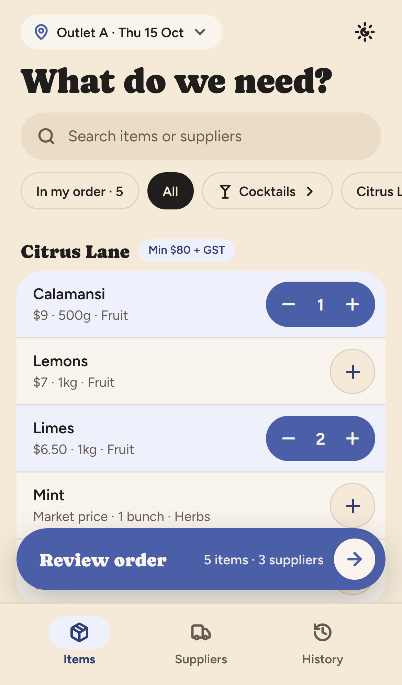
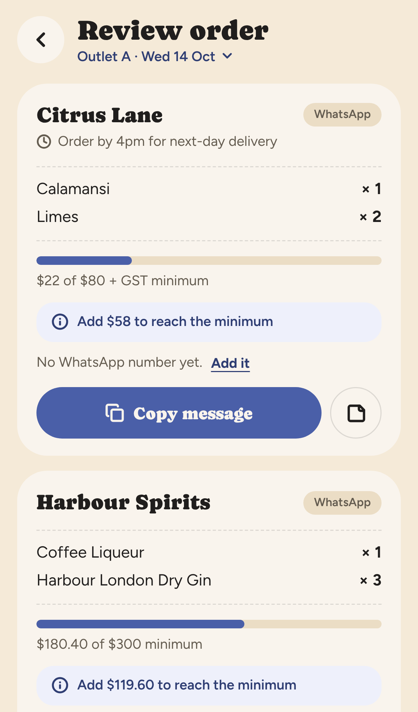
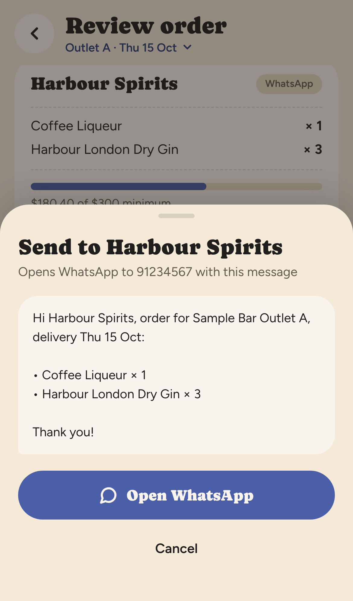
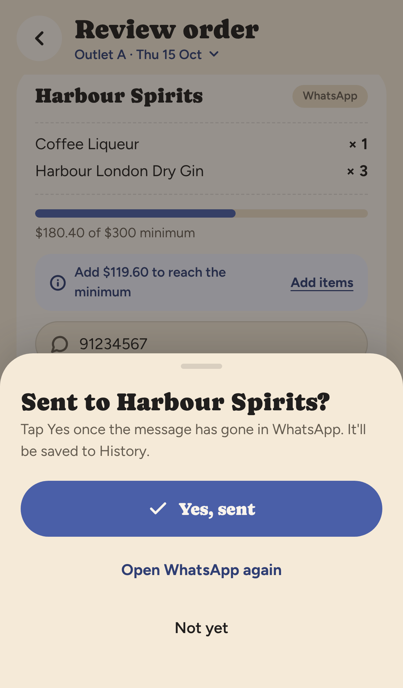
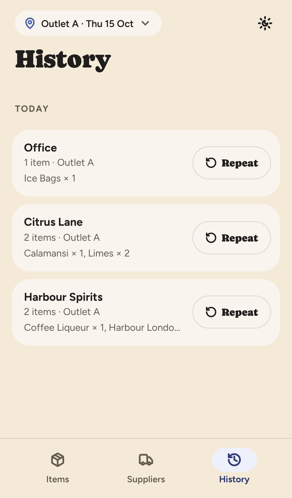
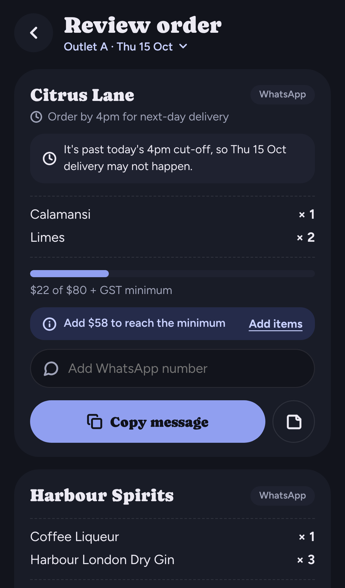

# Supplier Orders

A phone-first web app that turns a bar's weekly supplier ordering into a few taps: pick items, check each supplier's minimum order, and send the order as a ready-to-go WhatsApp message.

**[Live demo →](https://ruty27.github.io/Ordering-App/)** (runs on sample data; add it to your home screen to use it like an app)

<p>
  
  
  
  
  
  
</p>

## The problem

I'm a bartender at a multi-outlet cocktail bar in Singapore. Every week someone has to order stock from dozens of suppliers: spirits distributors, fruit and produce, syrups, packaging, online stores and our own office stock. Most orders go out over WhatsApp.

Before this app, that meant:
- Scrolling a large Google Sheet to find each item and who supplies it.
- Typing a separate WhatsApp message for every supplier, from memory.
- Getting caught out by **minimum order quantities (MOQs)** and **cut-off times**, which delayed deliveries.
- No record of what was ordered last week.

## What it does

- **Pick items fast:** search by item or supplier, or tap a chip to see just one supplier, one cocktail, or only what's already in your order. Tap + and −, or tap the number to type an amount like "2 ctn".
- **Count stock, order the difference:** tap **Count** on a supplier, set each item's usual amount once, then type what's on the shelf. The shortfall goes straight into the order, with the right units.
- **Grouped by supplier automatically:** "Review order" shows one card per supplier.
- **MOQ check:** a progress bar shows how close each order is to the supplier's minimum, and tells you how much more to add.
- **Cut-off reminders:** each supplier's ordering deadline and delivery days appear on its card.
- **Preview, then send:** see the exact message before WhatsApp opens: billing and delivery address, delivery date and time, then lines like "12 btls Sauvignon Blanc". Online stores get a copyable shopping list instead. When you come back, confirm it was sent before it goes into History, then jump straight to the next supplier.
- **Fix it on the spot:** below a minimum? "Add items" takes you to that supplier's items. No WhatsApp number yet? Type it right on the order card.
- **Delivery warnings:** flags when the delivery date doesn't suit a supplier (e.g. "only delivers on Mondays", or today's cut-off has passed).
- **History and repeat:** every sent order is saved by date; repeat any of them, or a supplier's last order, with one tap.
- **Outlets and delivery date:** one pill sets the outlet and delivery day; both go into the message.
- **Light and dark mode:** follows your phone, or pick one.
- **Works offline and installs on your phone:** it's a Progressive Web App (PWA), so it opens from the home screen like a normal app, even with no signal in the cellar.
- **Sync between phones:** sign in with an email and password, and your order, supplier numbers, history and data stay the same on every phone. Optional, and free with Supabase.
- **Cut-off reminders:** tick "Remind me at 3pm" on a supplier and your phone gets "Order Citrus Lane by 4pm" an hour before the cut-off on order days. Tapping it opens your order.
- **Team roles and approvals:** staff get their own login and join with a team code. Roles are fully custom: what each role can do (order directly, approve requests, manage the team) and which suppliers it sees. A newcomer who only sees "Office" sends a request; managers get a phone notification and approve it (the items go into their order) or put it on hold.
- **Your data stays private:** the public site ships with fake sample data. Real prices and suppliers are loaded with **Import data.json** and kept on your phone (and in your own Supabase account if you turn on sync), never in this repo.

## Using it with your own data

1. On the welcome screen tap **Import my data.json**, or later go to **Suppliers → Your data → Import data.json**.
2. Choose your `data.json` (see the format in [`CLAUDE.md`](CLAUDE.md), or copy [`data/data.json`](data/data.json)).
3. The app reloads with your items. Tap **Use sample data** to switch back.

To install: on iPhone, open the site in Safari → Share → **Add to Home Screen**. On Android (Chrome), use the menu → **Install app**.

### Setting up sync (optional)

Sync uses a free [Supabase](https://supabase.com) project.

1. Create a project.
2. In **SQL Editor**, run:
   ```sql
   create table public.app_state (
     user_id uuid primary key default auth.uid() references auth.users on delete cascade,
     state jsonb,
     data jsonb,
     updated_at timestamptz not null default now()
   );
   alter table public.app_state enable row level security;
   create policy "own row only" on public.app_state for all
     using (auth.uid() = user_id) with check (auth.uid() = user_id);
   ```
3. In **Authentication → Sign In / Providers → Email**, turn off **Confirm email** (sign-in uses email + password, so no emails are needed).
4. Put your Project URL and anon (publishable) key in [`sync.json`](sync.json). The key is meant to be public; the row-level security rule above means each login can only read its own data.

Create your account on your main phone first, then sign in on the others. If you won't use teams, you can turn off **Allow new users to sign up** once all your phones are signed in.

### Setting up teams, notifications and reminders (optional)

Teams need sync (above). Run these once in your Supabase project:

1. **Tables:** in **SQL Editor**, paste all of [`supabase/team.sql`](supabase/team.sql) and press **Run**. It adds teams, roles, members, requests and notification subscriptions, each locked down with row-level security. It's safe to run again.
2. **Notification keys:** the app needs a VAPID key pair. The public key goes in `sync.json` as `"vapid"`. Generate a pair with `npx web-push generate-vapid-keys` if you're setting this up yourself. Keep the private key out of the repo.
3. **Sender function:** in **Edge Functions → Deploy a new function → Via Editor**, name it `notify`, paste [`supabase/functions/notify/index.ts`](supabase/functions/notify/index.ts) and deploy. Then, in **Edge Functions → Secrets**, add `VAPID_PUBLIC_KEY`, `VAPID_PRIVATE_KEY` and `VAPID_SUBJECT` (`mailto:` plus your email).
4. **Trigger:** in **Database → Webhooks → Create a new hook**, name it `notify`, pick table `requests` and events **Insert** and **Update**. Choose type **Supabase Edge Functions**, pick `notify`, and add the auth header with the service key. Save.

In the app, the manager signs in and taps **Suppliers → Team → Create team**. The team starts with that phone's supplier list and WhatsApp numbers. Staff create their own account, then join with the team code. Everyone who should get alerts taps **Turn on notifications** once. On iPhone that works only from the home-screen app (iOS 16.4 or later).

**Cut-off reminders** need two more steps (after the three above):

5. In **SQL Editor**, run [`supabase/reminders.sql`](supabase/reminders.sql).
6. Deploy [`supabase/functions/remind/index.ts`](supabase/functions/remind/index.ts) as a function named `remind` (same way as `notify`; it uses the same secrets). Then, in **Integrations → Cron → Create job**, run it every 15 minutes (`*/15 * * * *`) with type **Supabase Edge Function** → `remind`.

People turn reminders on per supplier in the Suppliers tab. The reminder time is read from the supplier's cut-off text (e.g. "Order by 4pm").

Role limits on suppliers decide what each person sees in the app. They're for convenience, not secrecy: anyone in the team can technically read the team's full supplier list.

### Generating data.json from a spreadsheet

My real item list lives in a Google Sheet. Two small Python scripts convert an `.xlsx` export into `data.json`:

```bash
pip install openpyxl
python scripts/parse.py && python scripts/build.py
```

Business-specific settings (supplier name aliases, MOQs, cut-offs, outlets) live in `scripts/config.local.json`, which is kept out of git. [`scripts/config.example.json`](scripts/config.example.json) shows the format.

## How it's built

| Part | Choice | Why |
|---|---|---|
| App | One HTML file, plain JavaScript, no framework | Fast on a phone, nothing to install, easy to change |
| Design | Caprasimo + Figtree type, Lucide icons, indigo light/dark theme | Built from a high-fidelity design handoff |
| Storage | Browser `localStorage` | Free, private, works offline |
| Sync | Supabase (Postgres + email/password login, row-level security) | Free tier; each user can only read their own row |
| Teams | Postgres tables + security-definer functions, Web Push via a Supabase Edge Function | Roles are enforced by the database, not just the app |
| Data | JSON, generated from the team's Google Sheet | The sheet stays the source of truth |
| Offline / install | Web app manifest + service worker | Home-screen app without an app store |
| Hosting | GitHub Pages, deployed by GitHub Actions | Free; every push to `main` rebuilds and publishes |

```
index.template.html   the app
data/data.json        sample data (fake)
scripts/inject.py     builds dist/ (app + data + PWA files)
scripts/parse.py      spreadsheet → catalog.json
scripts/build.py      catalog → data.json, using config.local.json
sync.json             Supabase URL + public key (empty = sync off) + public push key
supabase/team.sql     teams, roles, requests (run once in Supabase)
supabase/reminders.sql       cut-off reminders (run once in Supabase)
supabase/functions/notify/   sends team request notifications
supabase/functions/remind/   sends cut-off reminders (every 15 min)
sw.js, manifest.webmanifest, icons/   PWA files
.github/workflows/deploy.yml          build & publish to GitHub Pages
```

Build locally with `python scripts/inject.py`, then open `dist/index.html`.

## How I built it with AI

I'm not a developer by training; I work behind the bar. I built this with **Claude** (Anthropic's AI assistant) as my pair programmer:

1. **Prototype in claude.ai:** I described how ordering actually works at the bar (suppliers, MOQs, cut-offs, WhatsApp). Claude helped me turn the Google Sheet into structured data and build the first version of the app. I tested it on real weekly orders and kept iterating on what got in the way.
2. **Clean-up and shipping with Claude Code:** I used Claude Code to:
   - turn it into a proper GitHub project
   - separate real business data from the public code
   - add the import feature
   - make it an installable offline app
   - set up free hosting with automatic deploys
   - add sync between phones
   - rebuild the app to match a high-fidelity design handoff (new look, bottom tabs, send sheets, history, light and dark mode).

What I learned: the hard part wasn't the code, it was knowing the workflow well enough to describe it precisely. Being the person who places the orders every week made the requirements obvious, and the AI made it possible to build them.

---

Built by Russell · Singapore
