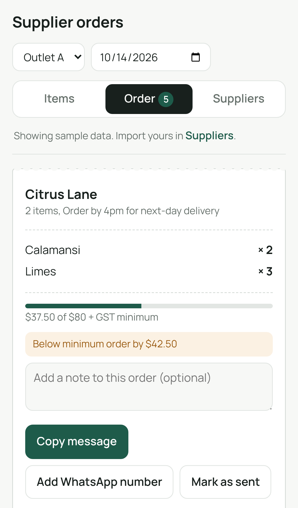
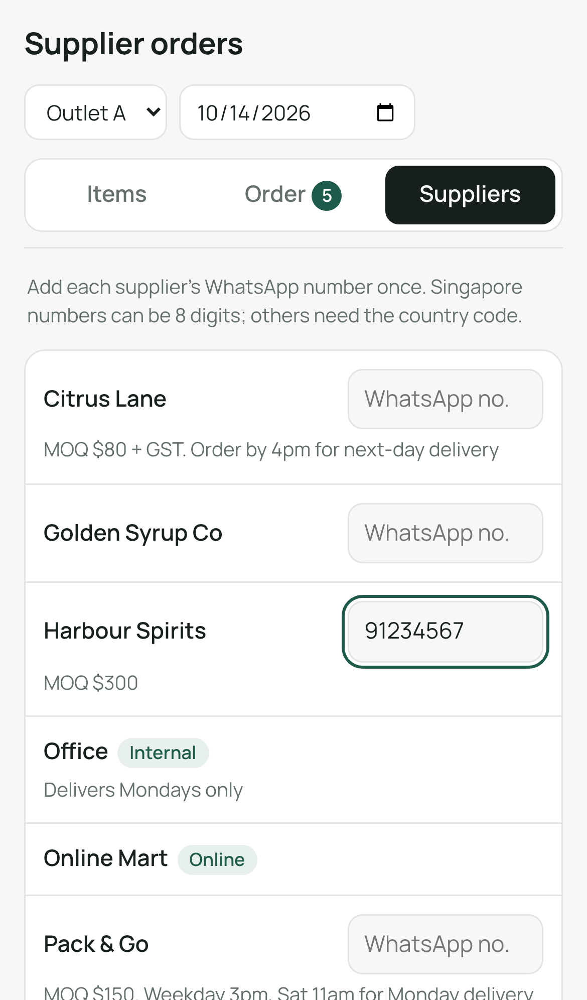

# Supplier Orders

A phone-first web app that turns a bar's weekly supplier ordering into a few taps: pick items, check each supplier's minimum order, and send the order as a ready-to-go WhatsApp message.

**[Live demo →](https://ruty27.github.io/Ordering-App/)** (runs on sample data; add it to your home screen to use it like an app)

<p>
  
  
  
</p>

## The problem

I'm a bartender at a multi-outlet cocktail bar in Singapore. Every week someone has to order stock from dozens of suppliers: spirits distributors, fruit and produce, syrups, packaging, online stores and our own office stock. Most orders go out over WhatsApp.

Before this app, that meant:
- Scrolling a large Google Sheet to find each item and who supplies it.
- Typing a separate WhatsApp message for every supplier, from memory.
- Getting caught out by **minimum order quantities (MOQs)** and **cut-off times**, which delayed deliveries.
- No record of what was ordered last week.

## What it does

- **Pick items fast:** search by item or supplier, or filter by cocktail to restock everything a drink needs.
- **Grouped by supplier automatically:** the Order tab shows one "chit" per supplier.
- **MOQ check:** a progress bar shows how close each order is to the supplier's minimum, and warns if it's below.
- **Cut-off reminders:** each supplier's ordering deadline and delivery days appear on its chit.
- **One-tap WhatsApp:** opens WhatsApp with the message already written ("Hi …, order for [bar] [outlet], delivery Wed 14 Oct: …"). Online stores get a copyable shopping list instead.
- **Repeat last order:** reuses a supplier's previous order with one tap.
- **Outlets and delivery date:** switch outlet and pick a delivery date; both go into the message.
- **Works offline and installs on your phone:** it's a Progressive Web App (PWA), so it opens from the home screen like a normal app, even with no signal in the cellar.
- **Sync between phones:** sign in with an emailed 6-digit code, and your order, supplier numbers, history and data stay the same on every phone. Optional, and free with Supabase.
- **Your data stays private:** the public site ships with fake sample data. Real prices and suppliers are loaded with **Import data.json** and kept on your phone (and in your own Supabase account if you turn on sync), never in this repo.

## Using it with your own data

1. Open the app and go to **Suppliers → Data → Import data.json**.
2. Choose your `data.json` (see the format in [`CLAUDE.md`](CLAUDE.md), or copy [`data/data.json`](data/data.json)).
3. The app reloads with your items. Tap **Use sample data** to switch back.

To install: on iPhone, open the site in Safari → Share → **Add to Home Screen**. On Android (Chrome), use the menu → **Install app**.

### Setting up sync (optional)

Sync uses a free [Supabase](https://supabase.com) project.

1. Create a project.
2. In **SQL Editor**, run:
   ```sql
   create table public.app_state (
     user_id uuid primary key default auth.uid() references auth.users on delete cascade,
     state jsonb,
     data jsonb,
     updated_at timestamptz not null default now()
   );
   alter table public.app_state enable row level security;
   create policy "own row only" on public.app_state for all
     using (auth.uid() = user_id) with check (auth.uid() = user_id);
   ```
3. In **Authentication → Emails → Templates → Magic Link**, put `{{ .Token }}` in the email so it sends a 6-digit code.
4. Put your Project URL and anon (publishable) key in [`sync.json`](sync.json). The key is meant to be public; the row-level security rule above means each login can only read its own data.

Sign in on your main phone first, then on the others.

### Generating data.json from a spreadsheet

My real item list lives in a Google Sheet. Two small Python scripts convert an `.xlsx` export into `data.json`:

```bash
pip install openpyxl
python scripts/parse.py && python scripts/build.py
```

Business-specific settings (supplier name aliases, MOQs, cut-offs, outlets) live in `scripts/config.local.json`, which is kept out of git. [`scripts/config.example.json`](scripts/config.example.json) shows the format.

## How it's built

| Part | Choice | Why |
|---|---|---|
| App | One HTML file, plain JavaScript, no framework | Fast on a phone, nothing to install, easy to change |
| Storage | Browser `localStorage` | Free, private, works offline |
| Sync | Supabase (Postgres + email-code login, row-level security) | Free tier; each user can only read their own row |
| Data | JSON, generated from the team's Google Sheet | The sheet stays the source of truth |
| Offline / install | Web app manifest + service worker | Home-screen app without an app store |
| Hosting | GitHub Pages, deployed by GitHub Actions | Free; every push to `main` rebuilds and publishes |

```
index.template.html   the app
data/data.json        sample data (fake)
scripts/inject.py     builds dist/ (app + data + PWA files)
scripts/parse.py      spreadsheet → catalog.json
scripts/build.py      catalog → data.json, using config.local.json
sync.json             Supabase URL + public key (empty = sync off)
sw.js, manifest.webmanifest, icons/   PWA files
.github/workflows/deploy.yml          build & publish to GitHub Pages
```

Build locally with `python scripts/inject.py`, then open `dist/index.html`.

## How I built it with AI

I'm not a developer by training; I work behind the bar. I built this with **Claude** (Anthropic's AI assistant) as my pair programmer:

1. **Prototype in claude.ai:** I described how ordering actually works at the bar (suppliers, MOQs, cut-offs, WhatsApp). Claude helped me turn the Google Sheet into structured data and build the first version of the app. I tested it on real weekly orders and kept iterating on what got in the way.
2. **Clean-up and shipping with Claude Code:** I used Claude Code to:
   - turn it into a proper GitHub project
   - separate real business data from the public code
   - add the import feature
   - make it an installable offline app
   - set up free hosting with automatic deploys
   - add sync between phones.

What I learned: the hard part wasn't the code, it was knowing the workflow well enough to describe it precisely. Being the person who places the orders every week made the requirements obvious, and the AI made it possible to build them.

---

Built by Russell · Singapore
